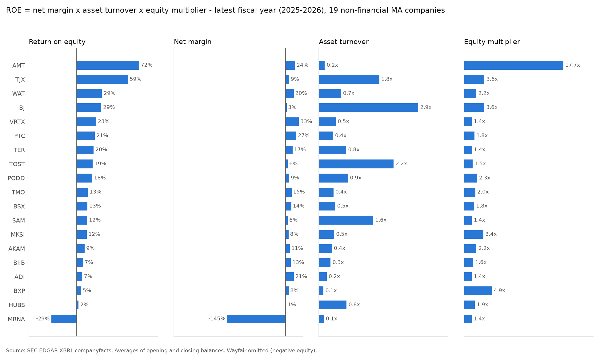
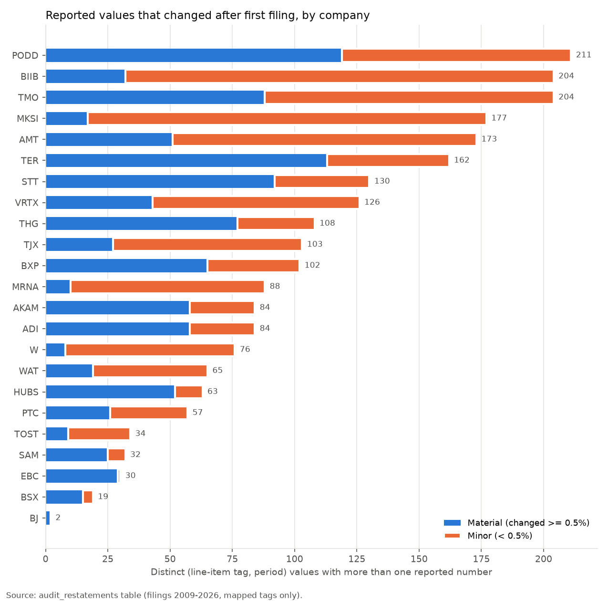

<!-- Generated by run.py from templates/README.md.tmpl. Edit the template, not this file. -->
# SEC Fundamentals Warehouse - Massachusetts public companies

Where does return on equity come from for 23 Massachusetts public companies? A DuckDB star schema built from SEC XBRL says three places: AMT through leverage (72% ROE, 17.7x equity multiplier), TJX through asset turnover (1.79x), VRTX through margin (32.9%).

     

<table>
<tr>
<td width="50%"></td>
<td width="50%"></td>
</tr>
</table>

## Results

From this run; full report in [`output/report.md`](output/report.md), every table as CSV in [`output/tables/`](output/tables/).

| Metric | Value |
|---|---|
| Companies (non-financial / bank or insurer) | 23 (20 / 3) |
| XBRL facts loaded -> rows in `fact_financials` | 608,414 -> 27,916 |
| Company-years modelled | 377 from fiscal 2007 |
| Values restated after first filing (0.5% or more) | 2,334 (1,035) |
| Data-quality checks: pass / fail / warn | 10 / 2 / 5 of 17 |
| Median non-financial ROE, latest fiscal year | 13.0% |

## Proof

- **16 tests** (`pytest`): tag mapping and priority, bank revenue, two-step dedupe, restatement audit, primary keys, Massachusetts universe, fiscal calendar, every SQL check runs.
- **17 SQL data-quality checks** run on every build; failures are kept visible in [`output/dq_results.csv`](output/dq_results.csv), not suppressed.
- **One command:** `make` builds the warehouse and runs the tests; from cache the pipeline takes a few seconds.
- **Data:** [SEC EDGAR XBRL companyfacts](https://www.sec.gov/edgar/sec-api-documentation) (96 MB) and SEC submissions, declared User-Agent, throttled to 5 requests per second.
- **Deterministic:** SHA-256 of every raw file recorded in `data/raw/manifest.json`; `run.py --offline` rebuilds from the cache only. Data as of 2026-10-27.

## Stack

Python 3.14 · duckdb 2.0.0 · matplotlib 3.11.2 · pandas 3.1.0 · pytest 9.2.0 · requests 2.34.2

## Run

```bash
python3 -m venv .venv && .venv/bin/pip install -r requirements.txt
.venv/bin/python run.py && .venv/bin/python -m pytest
```

## Structure

```
run.py           fetch -> load -> model -> analytics -> checks -> report
src/warehouse/   fetch.py, load.py, build.py, checks.py, report.py
sql/             staging, marts, analytics, checks, examples
seeds/           companies, concepts, XBRL tag map, overrides
templates/       README and docs/DETAILS.md templates (filled by run.py)
output/          report.md/html, charts, tables, data-quality results
```

---

Full method, limitations and interview-level detail: [docs/DETAILS.md](docs/DETAILS.md) · MIT License
