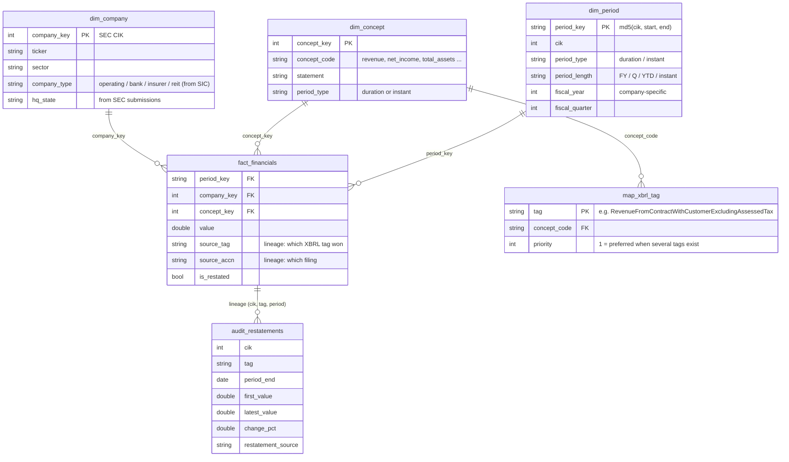

<!-- Generated by run.py from templates/DETAILS.md.tmpl. Edit the template, not this file. -->
# SEC Fundamentals Warehouse - Massachusetts public companies

A DuckDB star-schema warehouse of financial statements for 23 Massachusetts-headquartered public companies, built from SEC EDGAR XBRL data, with 17 SQL data-quality checks and a generated report.

**Headline:** return on equity in this group comes from three different places. In the latest fiscal year AMT leads at 72% ROE mostly through leverage (equity multiplier 17.7x, asset turnover 0.17x); TJX reaches 59% on a 9.1% net margin by turning its assets over 1.79x a year; VRTX has the highest net margin (32.9%) but a 23% ROE because it carries little leverage (1.37x). The median non-financial ROE is 13.0%.


Full report: [`output/report.md`](../output/report.md) (also [`output/report.html`](../output/report.html)). Every table is also a CSV in [`output/tables/`](../output/tables/).

## What's in it

| | |
|---|---|
| Companies | 23 (20 non-financial, 3 bank/insurer). HQ state verified against SEC's own address data. Excluded from the seed list: KDP (business address is FRISCO, TX (not Massachusetts)), HOLX (not in SEC company_tickers.json (delisted or taken private)), IRBT (not in SEC company_tickers.json (delisted or taken private)) |
| Raw data | 608,414 XBRL facts from SEC `companyfacts` JSON (96 MB, cached in `data/raw/`, not committed) |
| Staging | 516,762 US-GAAP, USD facts from 10-K/10-Q filings |
| Model | 25 standard line items mapped from 60 XBRL tags; 3,949 fiscal periods; 27,916 rows in `fact_financials`; 377 company-years from fiscal 2007 |
| Restatements | 2,334 values changed after they were first filed (1,035 by 0.5% or more); 1,961 fact rows (7.0%) come from a tag-period whose value was revised at least once |
| Data quality | 17 checks: 10 pass, 2 fail, 5 warn |

## Schema



Layers (all plain SQL in [`sql/`](../sql/), run in file order):

- `raw_facts`, `raw_companies` - SEC JSON flattened, nothing changed.
- `sql/staging/` - `stg_facts`: typed, US-GAAP + USD + 10-K/10-Q only. Still one row per fact per filing.
- `sql/marts/` - `dim_company`, `dim_concept` + `map_xbrl_tag`, `dim_period`, `fact_financials`, `audit_restatements`, and `mart_annual` (one wide row per company-year).
- `sql/analytics/` - ratios, the ranked latest-year table, sector medians, the bank/insurer scorecard, coverage.
- `sql/checks/` - one data-quality assertion per file.

**Two-step dedupe.** The same number appears in many filings (each 10-K repeats two prior years). Step 1 keeps, for each company + tag + period, the most recently filed value (ties broken by accession number); every older version that differs goes to `audit_restatements`. Step 2 picks one tag per line item by priority: `Revenues` beats `RevenueFromContractWithCustomerExcludingAssessedTax` beats `SalesRevenueNet`. `Revenues` ranks first on purpose: the ASC 606 tag excludes lease income, and for American Tower it is less than 10% of total revenue (check 12). One reviewed exception lives in `seeds/tag_overrides.csv` (Boston Scientific's `Revenues` tag for 2012-2016 is not its net sales).

**Fiscal calendar.** SEC's `fy` field belongs to the filing, not the number: a FY2025 10-K stamps its FY2024 and FY2023 comparatives `fy=2025`. `dim_period` instead learns each company's naming convention from its latest 10-K and applies it to every period. That matters: TJX and BJ's both have a year ending 2026-01-31; TJX calls it fiscal 2026, BJ's calls it fiscal 2025.

**Two one-year periods for the same fiscal year.** State Street and BXP tag some years twice, once as Jan 1 - Dec 31 and once as Dec 31 - Dec 31 (366 days), in different 10-Ks. `mart_annual` keeps one with a fixed rule: more line items first, then the later end date, then the more recently filed facts (the same "latest filed wins" rule as dedupe step 1), then the later start date. Before this rule the choice between tied periods depended on row order, so State Street's fiscal 2011 start date could flip between runs.

**Banks and the insurer.** State Street and Eastern Bankshares get revenue = net interest income + noninterest income (the ASC 606 revenue tag covers fees only). Gross margin, operating margin, free cash flow, cash conversion, debt/equity and asset turnover are not computed for banks and insurers: deposits and policy reserves are their raw material, not financing, and their operating cash flow swings with trading and lending balances. They are compared on ROE, ROA, equity/assets, efficiency ratio and NII share in a separate table.

## Data-quality results

17 checks, each a SQL query that returns the rows that break the rule. 10 pass, 2 fail, 5 warn.

| check | severity | status | violating_rows | rows_tested |
| --- | --- | --- | --- | --- |
| Primary key: fact_financials | error | PASS | 0 | 27,916 |
| Primary keys: dimensions | error | PASS | 0 | - |
| Not-null keys and values | error | PASS | 0 | - |
| Referential integrity | error | PASS | 0 | - |
| One fiscal-year period per company-year | error | PASS | 0 | - |
| Universe is Massachusetts-headquartered | error | PASS | 0 | 23 |
| Assets = Liabilities-and-equity total | error | FAIL | 3 | 1,377 |
| Balance-sheet identity A = L + E | error | FAIL | 26 | 1,039 |
| Revenue > 0 | error | PASS | 0 | 377 |
| Year-over-year jumps > 5x | warn | WARN | 66 | 1,835 |
| Fiscal-year label matches the filing's own fy | warn | WARN | 12 | 333 |
| Revenue tag variants disagree | warn | WARN | 12 | - |
| Gross profit = revenue - cost of revenue | warn | WARN | 1 | 177 |
| Core line items present in latest fiscal year | warn | WARN | 4 | - |
| Latest fiscal year is recent | warn | PASS | 0 | - |
| Capex reported as a positive outflow | warn | PASS | 0 | - |
| DuPont components multiply back to ROE | error | PASS | 0 | 295 |

Why the failures and warnings happen:

- **Assets = liabilities-and-equity total (3 of 1,377 balance sheets fail: AMT (1), MKSI (1), TJX (1)).** The filers' own statements balance. The break comes from my dedupe: it takes the latest value *per tag*, and in these cases a later filing re-reported only `Assets` for an old date (after a reclassification) and not the matching total. The fix would be to take each balance sheet from a single filing; I left the check failing so the trade-off stays visible.
- **A = L + E (26 of 1,039 fail: BXP (12), VRTX (9), AKAM (2), W (2), PODD (1)).** Most are redeemable or mezzanine equity recorded under company-specific extension tags that a standard-tag model can't see (BXP's redeemable partnership units, Wayfair's pre-IPO convertible preferred, Vertex's redeemable noncontrolling interest in 2011-2013). Akamai's 2015-2016 gaps (liabilities + equity exceed assets by about 1%) are not explained by any standard tag.
- **Fiscal-year label (12 warnings: TJX (12)).** TJX tagged its year ended 2021-01-30 as fy 2020 and the next year as fy 2022, so fy 2021 never appears. The warehouse uses the current convention for all years.
- **Revenue tag disagreement (12 warnings: AMT (8), PODD (2), ADI (1), BSX (1)).** Mostly American Tower's lease revenue, which the ASC 606 tag excludes. Tag priority picks the total.
- **YoY > 5x (66 of 1,835 values flagged: 38 net_income, 19 operating_cash_flow, 6 equity_parent, 3 revenue).** Mostly net income and operating cash flow crossing or sitting near zero (for example TJX's fiscal 2021 pandemic year). The revenue flags are real business events: MRNA 2020 (13.38x), MRNA 2021 (23x), VRTX 2011 (9.84x) (Moderna's COVID vaccine, Vertex's 2011 hepatitis C launch). Flagged for review, not errors.
- **Coverage (4 missing core items in the latest year):** BIIB: operating_income; BXP: operating_income; TJX: operating_income; TMO: gross_profit.

## Example query

[`sql/examples/dupont_top5.sql`](../sql/examples/dupont_top5.sql):

```sql
-- Where does return on equity come from? DuPont split for the five highest-ROE
-- non-financial companies in their latest fiscal year.
select
    ticker,
    fiscal_year,
    round(roe, 3)               as roe,
    round(net_margin, 3)        as net_margin,
    round(asset_turnover, 2)    as asset_turnover,
    round(equity_multiplier, 2) as equity_multiplier
from ratios_annual r
where not is_financial
  and roe is not null
  and fiscal_year = (select max(fiscal_year) from ratios_annual x where x.cik = r.cik)
order by roe desc, ticker
limit 5;
```

Output from this run:

| ticker | fiscal_year | roe | net_margin | asset_turnover | equity_multiplier |
| --- | --- | --- | --- | --- | --- |
| AMT | 2025 | 0.719 | 0.238 | 0.17 | 17.66 |
| TJX | 2026 | 0.591 | 0.091 | 1.79 | 3.63 |
| WAT | 2025 | 0.293 | 0.203 | 0.66 | 2.19 |
| BJ | 2025 | 0.286 | 0.027 | 2.94 | 3.6 |
| VRTX | 2025 | 0.225 | 0.329 | 0.5 | 1.37 |

## Limitations of XBRL data

- **Standard tags only.** Companies may invent extension tags. Thermo Fisher's cost of revenue and several mezzanine-equity lines use them, so they show as missing. `companyfacts` also drops dimensional facts, so there is no segment data.
- **Subtotals are optional.** Total liabilities is not tagged in the latest year by ADI, BSX, TJX, TMO; the mart derives it as (liabilities + equity) - equity - mezzanine and labels the source.
- **"Latest fiscal year" is not one calendar window.** PTC's year ends in September, Analog Devices' in early November, and TJX's and BJ's in late January.
- **Debt is approximate.** Long-term debt tags vary (total vs non-current vs convertible notes); leases are excluded. No debt figure for: VRTX, TER, TOST, SAM, BXP, HUBS, W. Some of these, like Vertex and Teradyne, report little or no long-term debt.
- **ROE needs positive equity.** ROE and the equity multiplier are left blank for W (negative shareholders' equity).
- **"Latest filed" is a choice.** The warehouse shows numbers as last reported, including recasts for discontinued operations. A point-in-time (as-first-reported) view is available from `audit_restatements`.
- **Survivorship.** The universe is today's Massachusetts-HQ list. Hologic and iRobot are no longer in SEC's ticker file, and Keurig Dr Pepper's SEC address is in Texas.

## How to run

Requires Python 3.12+ (developed on 3.14).

```bash
make            # creates .venv, installs requirements, runs the pipeline, runs pytest
# or
python3 -m venv .venv && .venv/bin/pip install -r requirements.txt
.venv/bin/python run.py            # downloads ~96 MB from SEC on first run, then uses the cache
.venv/bin/python run.py --offline  # rebuild from cached JSON only
.venv/bin/python -m pytest
```

The first run makes 0 requests at 5 per second (SEC's limit is 10) with a declared User-Agent. The rest of the pipeline takes a few seconds. Outputs: `data/warehouse.duckdb` (gitignored), `output/report.md`, `output/report.html`, `output/charts/*.png`, `output/tables/*.csv`, `output/dq_results.csv`, `output/dq_violations/*.csv`, and this README.

Layout:

```
run.py                 one command: fetch -> load -> model -> analytics -> checks -> report
src/warehouse/         fetch.py, load.py, build.py, checks.py, report.py
sql/staging|marts|analytics|checks|examples
seeds/                 companies.csv, concepts.csv, tag_map.csv, tag_overrides.csv
tests/                 pytest: tag mapping, dedupe, restatement audit, fiscal calendar
templates/             README template (numbers filled in by run.py)
```

Data as of 2026-10-27.

---

Every number here is produced by the code in this repo.
