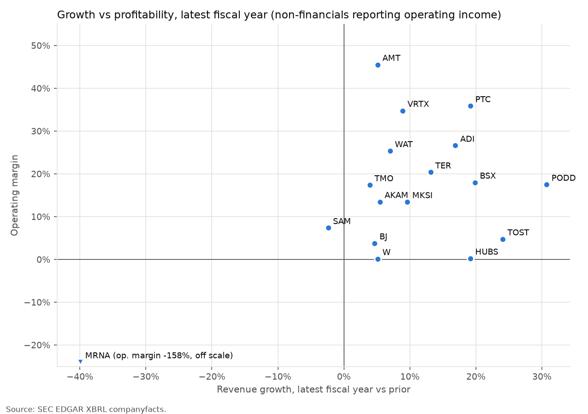

# Massachusetts public-company fundamentals - warehouse report

Generated 2026-10-27 by `python run.py` from SEC EDGAR XBRL data. 23 companies, 377 company-years (fiscal 2007 onward), 27,916 rows in `fact_financials`. Money columns are USD millions.

## Universe

| ticker | entity_name | sector | industry_group | company_type | sic | hq_city |
| --- | --- | --- | --- | --- | --- | --- |
| BJ | BJ's Wholesale Club Holdings, Inc. | Consumer | Warehouse clubs | operating | 5331 | MARLBOROUGH |
| SAM | BOSTON BEER CO INC | Consumer | Beverages | operating | 2082 | BOSTON |
| TJX | TJX COMPANIES INC /DE/ | Consumer | Off-price retail | operating | 5651 | FRAMINGHAM |
| W | Wayfair Inc. | Consumer | E-commerce | operating | 5961 | BOSTON |
| EBC | Eastern Bankshares, Inc. | Financials | Bank (regional) | bank | 6035 | BOSTON |
| STT | STATE STREET CORP | Financials | Bank (custody) | bank | 6022 | BOSTON |
| THG | HANOVER INSURANCE GROUP, INC. | Financials | Insurance | insurer | 6331 | WORCESTER |
| BIIB | BIOGEN INC. | Health Care | Biotech | operating | 2836 | CAMBRIDGE |
| BSX | BOSTON SCIENTIFIC CORP | Health Care | Medical devices | operating | 3841 | MARLBOROUGH |
| MRNA | Moderna, Inc. | Health Care | Biotech | operating | 2836 | CAMBRIDGE |
| PODD | INSULET CORP | Health Care | Medical devices | operating | 3841 | ACTON |
| TMO | THERMO FISHER SCIENTIFIC INC. | Health Care | Life-science tools | operating | 3829 | WALTHAM |
| VRTX | VERTEX PHARMACEUTICALS INC / MA | Health Care | Biotech | operating | 2834 | BOSTON |
| WAT | WATERS CORP /DE/ | Health Care | Life-science tools | operating | 3826 | MILFORD |
| AMT | AMERICAN TOWER CORP /MA/ | Real Estate | REIT (towers) | reit | 6798 | BOSTON |
| BXP | BXP, Inc. | Real Estate | REIT (office) | reit | 6798 | BOSTON |
| ADI | ANALOG DEVICES INC | Technology | Semiconductors | operating | 3674 | WILMINGTON |
| AKAM | AKAMAI TECHNOLOGIES INC | Technology | Internet infrastructure | operating | 7389 | CAMBRIDGE |
| HUBS | HUBSPOT INC | Technology | Software | operating | 7372 | CAMBRIDGE |
| MKSI | MKS INC | Technology | Semiconductor equipment | operating | 3823 | ANDOVER |
| PTC | PTC INC. | Technology | Software | operating | 7372 | BOSTON |
| TER | TERADYNE, INC | Technology | Semiconductor equipment | operating | 3825 | NORTH READING |
| TOST | Toast, Inc. | Technology | Fintech software | operating | 7374 | BOSTON |

Seed tickers that were excluded, and why:

| ticker | entity_name | exclusion_reason |
| --- | --- | --- |
| KDP | Keurig Dr Pepper Inc. | business address is FRISCO, TX (not Massachusetts) |
| HOLX | - | not in SEC company_tickers.json (delisted or taken private) |
| IRBT | - | not in SEC company_tickers.json (delisted or taken private) |

## Latest fiscal year - ranked comparison (non-financials)

Ranks are within the non-financial group; `-` means the line item is not reported or the ratio is not meaningful (e.g. ROE with negative equity).

| rank_roe | ticker | sector | fiscal_year | period_end | revenue | revenue_growth | revenue_cagr_5y | gross_margin | operating_margin | net_margin | roe | fcf_margin | cash_conversion | debt_to_equity | rank_operating_margin | rank_revenue_growth | rank_fcf_margin |
| --- | --- | --- | --- | --- | --- | --- | --- | --- | --- | --- | --- | --- | --- | --- | --- | --- | --- |
| 1 | AMT | Real Estate | 2025 | 2025-12-31 | 10,645 | 5.1% | 5.8% | - | 45.5% | 23.8% | 71.9% | 35.5% | 2.16x | 10.19x | 1 | 14 | 2 |
| 2 | TJX | Consumer | 2026 | 2026-01-31 | 60,372 | 7.1% | 13.4% | 31.0% | - | 9.1% | 59.1% | 8.1% | 1.25x | 0.28x | - | 10 | 17 |
| 3 | WAT | Health Care | 2025 | 2025-12-31 | 3,165 | 7.0% | 6.0% | 59.3% | 25.4% | 20.3% | 29.3% | 17.1% | 1.02x | 0.55x | 5 | 11 | 10 |
| 4 | BJ | Consumer | 2025 | 2026-01-31 | 21,457 | 4.7% | 6.8% | 18.6% | 3.8% | 2.7% | 28.6% | 1.5% | 1.78x | 0.18x | 14 | 15 | 19 |
| 5 | VRTX | Health Care | 2025 | 2025-12-31 | 12,001 | 8.9% | 14.1% | 86.2% | 34.8% | 32.9% | 22.5% | 26.6% | 0.92x | - | 3 | 9 | 5 |
| 6 | PTC | Technology | 2025 | 2025-09-30 | 2,739 | 19.2% | 13.4% | 83.8% | 35.9% | 26.8% | 20.9% | 31.3% | 1.18x | 0.31x | 2 | 4 | 3 |
| 7 | TER | Technology | 2025 | 2025-12-31 | 3,190 | 13.1% | 0.4% | 58.2% | 20.4% | 17.4% | 19.7% | 14.1% | 1.22x | - | 6 | 7 | 12 |
| 8 | TOST | Technology | 2025 | 2025-12-31 | 6,153 | 24.1% | 49.5% | 25.9% | 4.7% | 5.6% | 18.6% | 9.9% | 1.93x | - | 13 | 2 | 16 |
| 9 | PODD | Health Care | 2025 | 2025-12-31 | 2,708 | 30.7% | 24.5% | 71.6% | 17.5% | 9.1% | 18.1% | 13.9% | 2.30x | 0.63x | 8 | 1 | 13 |
| 10 | TMO | Health Care | 2025 | 2025-12-31 | 44,556 | 3.9% | 6.7% | - | 17.4% | 15.0% | 13.0% | 14.1% | 1.17x | 0.73x | 9 | 16 | 11 |
| 11 | BSX | Health Care | 2025 | 2025-12-31 | 20,074 | 19.9% | 15.2% | 69.0% | 18.0% | 14.4% | 12.6% | 18.2% | 1.56x | 0.47x | 7 | 3 | 9 |
| 12 | SAM | Consumer | 2025 | 2025-12-27 | 1,965 | -2.4% | 2.5% | 48.5% | 7.4% | 5.5% | 12.3% | 11.0% | 2.49x | - | 12 | 19 | 15 |
| 13 | MKSI | Technology | 2025 | 2025-12-31 | 3,931 | 9.6% | 11.0% | 46.7% | 13.4% | 7.5% | 11.7% | 12.6% | 2.19x | 1.53x | 11 | 8 | 14 |
| 14 | AKAM | Technology | 2025 | 2025-12-31 | 4,208 | 5.4% | 5.6% | 58.9% | 13.5% | 10.7% | 9.2% | 24.0% | 3.36x | 0.82x | 10 | 12 | 6 |
| 15 | BIIB | Health Care | 2025 | 2025-12-31 | 9,891 | 2.2% | -6.0% | 75.7% | - | 13.1% | 7.4% | 20.7% | 1.71x | 0.34x | - | 17 | 8 |
| 16 | ADI | Technology | 2025 | 2025-11-01 | 11,020 | 16.9% | 14.5% | 61.5% | 26.6% | 20.6% | 6.6% | 38.8% | 2.12x | 0.24x | 4 | 6 | 1 |
| 17 | BXP | Real Estate | 2025 | 2025-12-31 | 3,482 | 2.2% | 4.7% | - | - | 7.9% | 5.2% | 29.5% | 4.50x | - | - | 18 | 4 |
| 18 | HUBS | Technology | 2025 | 2025-12-31 | 3,131 | 19.2% | 28.8% | 83.8% | 0.2% | 1.5% | 2.3% | 22.6% | 16.57x | - | 15 | 5 | 7 |
| 19 | MRNA | Health Care | 2025 | 2025-12-31 | 1,944 | -39.9% | 19.3% | 55.3% | -158.1% | -145.2% | -28.9% | -106.2% | - | 0.07x | 17 | 20 | 20 |
| - | W | Consumer | 2025 | 2025-12-31 | 12,457 | 5.1% | -2.5% | 30.2% | 0.1% | -2.5% | - | 3.7% | - | - | 16 | 13 | 18 |

## DuPont decomposition (latest fiscal year)

| ticker | roe | net_margin | asset_turnover | equity_multiplier |
| --- | --- | --- | --- | --- |
| AMT | 71.9% | 23.8% | 0.17x | 17.66x |
| TJX | 59.1% | 9.1% | 1.79x | 3.63x |
| WAT | 29.3% | 20.3% | 0.66x | 2.19x |
| BJ | 28.6% | 2.7% | 2.94x | 3.60x |
| VRTX | 22.5% | 32.9% | 0.50x | 1.37x |
| PTC | 20.9% | 26.8% | 0.42x | 1.85x |
| TER | 19.7% | 17.4% | 0.81x | 1.41x |
| TOST | 18.6% | 5.6% | 2.22x | 1.51x |
| PODD | 18.1% | 9.1% | 0.86x | 2.30x |
| TMO | 13.0% | 15.0% | 0.43x | 2.02x |
| BSX | 12.6% | 14.4% | 0.48x | 1.81x |
| SAM | 12.3% | 5.5% | 1.61x | 1.39x |
| MKSI | 11.7% | 7.5% | 0.45x | 3.45x |
| AKAM | 9.2% | 10.7% | 0.39x | 2.22x |
| BIIB | 7.4% | 13.1% | 0.34x | 1.64x |
| ADI | 6.6% | 20.6% | 0.23x | 1.39x |
| BXP | 5.2% | 7.9% | 0.13x | 4.95x |
| HUBS | 2.3% | 1.5% | 0.82x | 1.92x |
| MRNA | -28.9% | -145.2% | 0.15x | 1.35x |

## Sector medians (latest fiscal year)

| sector | companies | revenue_growth | gross_margin | operating_margin | net_margin | roe | roa | fcf_margin | cash_conversion | debt_to_equity |
| --- | --- | --- | --- | --- | --- | --- | --- | --- | --- | --- |
| Consumer | 4 | 4.9% | 30.6% | 3.8% | 4.1% | 28.6% | 8.4% | 5.9% | 1.78x | 0.23x |
| Financials | 3 | 5.7% | - | - | 12.2% | 11.1% | 0.8% | - | - | - |
| Health Care | 7 | 7.0% | 70.3% | 17.7% | 14.4% | 13.0% | 7.0% | 17.1% | 1.37x | 0.51x |
| Real Estate | 2 | 3.6% | - | 45.5% | 15.9% | 38.6% | 2.6% | 32.5% | 3.33x | 10.19x |
| Technology | 7 | 16.9% | 58.9% | 13.5% | 10.7% | 11.7% | 4.7% | 22.6% | 2.12x | 0.57x |

## Banks and insurer (separate treatment)

Revenue for banks = net interest income + noninterest income. Gross/operating margin, FCF, cash conversion, debt/equity and asset turnover are not computed for financials.

| ticker | company_type | fiscal_year | period_end | revenue | net_income | total_assets | shareholders_equity | roe | roa | equity_multiplier | equity_to_assets | efficiency_ratio | nii_share_of_revenue | deposits_to_assets | net_margin |
| --- | --- | --- | --- | --- | --- | --- | --- | --- | --- | --- | --- | --- | --- | --- | --- |
| EBC | bank | 2024 | 2024-12-31 | 732 | 120 | 25,558 | 3,612 | 3.6% | 0.5% | 7.09x | 14.1% | 69.5% | 83.1% | 83.4% | 16.3% |
| EBC | bank | 2025 | 2025-12-31 | 723 | 88 | 30,587 | 4,341 | 2.2% | 0.3% | 7.06x | 14.2% | 82.6% | 114.7% | 83.3% | 12.2% |
| STT | bank | 2024 | 2024-12-31 | 13,079 | 2,687 | 353,240 | 25,326 | 10.9% | 0.8% | 13.24x | 7.2% | 72.9% | 22.3% | 74.1% | 20.5% |
| STT | bank | 2025 | 2025-12-31 | 13,940 | 2,945 | 366,047 | 27,841 | 11.1% | 0.8% | 13.53x | 7.6% | 72.8% | 21.2% | 74.9% | 21.1% |
| THG | insurer | 2024 | 2024-12-31 | 6,237 | 426 | 15,274 | 2,842 | 16.1% | 2.9% | 5.63x | 18.6% | - | - | - | 6.8% |
| THG | insurer | 2025 | 2025-12-31 | 6,594 | 662 | 16,946 | 3,572 | 20.7% | 4.1% | 5.02x | 21.1% | - | - | - | 10.0% |

## Data quality

17 checks: 10 pass, 2 fail (error severity), 5 warn. Violating rows for each check are in `output/dq_violations/`.

| check | severity | status | violating_rows | rows_tested |
| --- | --- | --- | --- | --- |
| Primary key: fact_financials | error | PASS | 0 | 27,916 |
| Primary keys: dimensions | error | PASS | 0 | - |
| Not-null keys and values | error | PASS | 0 | - |
| Referential integrity | error | PASS | 0 | - |
| One fiscal-year period per company-year | error | PASS | 0 | - |
| Universe is Massachusetts-headquartered | error | PASS | 0 | 23 |
| Assets = Liabilities-and-equity total | error | FAIL | 3 | 1,377 |
| Balance-sheet identity A = L + E | error | FAIL | 26 | 1,039 |
| Revenue > 0 | error | PASS | 0 | 377 |
| Year-over-year jumps > 5x | warn | WARN | 66 | 1,835 |
| Fiscal-year label matches the filing's own fy | warn | WARN | 12 | 333 |
| Revenue tag variants disagree | warn | WARN | 12 | - |
| Gross profit = revenue - cost of revenue | warn | WARN | 1 | 177 |
| Core line items present in latest fiscal year | warn | WARN | 4 | - |
| Latest fiscal year is recent | warn | PASS | 0 | - |
| Capex reported as a positive outflow | warn | PASS | 0 | - |
| DuPont components multiply back to ROE | error | PASS | 0 | 295 |

### Assets = Liabilities-and-equity total - 3 rows

| ticker | period_end | assets | l_and_e | rel_diff |
| --- | --- | --- | --- | --- |
| AMT | 2013-12-31 | 20,214 | 20,284 | -0.3% |
| MKSI | 2011-12-31 | 1,134 | 1,119 | 1.3% |
| TJX | 2014-02-01 | 10,098 | 10,201 | -1.0% |

### Balance-sheet identity A = L + E - 26 rows

| ticker | period_end | assets | liabilities | equity_used | temporary_equity | gap | rel_diff |
| --- | --- | --- | --- | --- | --- | --- | --- |
| AKAM | 2015-12-31 | 4,182 | 1,061 | 3,163 | - | -42 | -1.0% |
| AKAM | 2016-12-31 | 4,373 | 1,149 | 3,270 | - | -46 | -1.1% |
| BXP | 2009-06-30 | 11,581 | 6,455 | 4,444 | 56 | 626 | 5.4% |
| BXP | 2012-09-30 | 15,142 | 9,345 | 5,666 | - | 130 | 0.9% |
| BXP | 2012-12-31 | 15,462 | 9,619 | 5,635 | - | 208 | 1.4% |
| BXP | 2013-03-31 | 15,623 | 9,609 | 5,805 | - | 209 | 1.3% |
| BXP | 2013-06-30 | 19,463 | 12,569 | 6,684 | - | 209 | 1.1% |
| BXP | 2013-09-30 | 19,520 | 12,611 | 6,742 | - | 166 | 0.9% |
| BXP | 2014-03-31 | 18,980 | 11,825 | 7,003 | - | 152 | 0.8% |
| BXP | 2014-06-30 | 18,899 | 11,763 | 7,014 | - | 122 | 0.6% |
| BXP | 2014-09-30 | 18,875 | 11,721 | 7,048 | 2 | 104 | 0.5% |
| BXP | 2014-12-31 | 19,887 | 11,879 | 7,903 | 1 | 105 | 0.5% |
| BXP | 2015-03-31 | 19,179 | 11,074 | 7,999 | 1 | 106 | 0.5% |
| BXP | 2015-06-30 | 19,114 | 11,019 | 7,988 | 0 | 106 | 0.6% |
| PODD | 2014-06-30 | 325 | 242 | 78 | - | 5 | 1.5% |
| VRTX | 2011-06-30 | 1,763 | 1,314 | 413 | - | 36 | 2.1% |
| VRTX | 2011-09-30 | 2,092 | 1,361 | 694 | - | 37 | 1.8% |
| VRTX | 2011-12-31 | 2,204 | 1,239 | 928 | - | 37 | 1.7% |
| VRTX | 2012-03-31 | 2,346 | 1,240 | 1,068 | - | 37 | 1.6% |
| VRTX | 2012-06-30 | 2,605 | 1,361 | 1,206 | - | 38 | 1.5% |
| VRTX | 2012-09-30 | 2,719 | 1,454 | 1,226 | - | 38 | 1.4% |
| VRTX | 2013-03-31 | 2,392 | 1,415 | 938 | - | 39 | 1.6% |
| VRTX | 2013-06-30 | 2,584 | 1,036 | 1,509 | - | 39 | 1.5% |
| VRTX | 2013-09-30 | 2,583 | 1,096 | 1,447 | - | 40 | 1.5% |
| W | 2013-12-31 | 196 | 146 | -191 | - | 241 | 122.9% |
| W | 2014-09-30 | 261 | 169 | -306 | - | 397 | 152.6% |

### Revenue tag variants disagree - 12 rows

| ticker | company_type | period_end | revenues_tag | asc606_tag | rel_diff |
| --- | --- | --- | --- | --- | --- |
| ADI | operating | 2017-10-28 | 5,108 | 5,246 | -2.7% |
| AMT | reit | 2018-12-31 | 7,440 | 491 | 93.4% |
| AMT | reit | 2019-12-31 | 7,580 | 527 | 93.0% |
| AMT | reit | 2020-12-31 | 8,042 | 496 | 93.8% |
| AMT | reit | 2021-12-31 | 9,357 | 717 | 92.3% |
| AMT | reit | 2022-12-31 | 9,645 | 841 | 91.3% |
| AMT | reit | 2023-12-31 | 10,012 | 747 | 92.5% |
| AMT | reit | 2024-12-31 | 10,127 | 775 | 92.3% |
| AMT | reit | 2025-12-31 | 10,645 | 936 | 91.2% |
| BSX | operating | 2016-12-31 | 9,076 | 8,386 | 7.6% |
| PODD | operating | 2021-12-31 | 1,099 | 1,041 | 5.3% |
| PODD | operating | 2022-12-31 | 1,305 | 1,055 | 19.1% |

### Gross profit = revenue - cost of revenue - 1 rows

| ticker | fiscal_year | revenue_reported | cost_of_revenue | gross_profit_reported | rel_diff |
| --- | --- | --- | --- | --- | --- |
| ADI | 2017 | 5.108e+09 | 2.078e+09 | 3.168e+09 | 2.7% |

### Core line items present in latest fiscal year - 4 rows

| ticker | company_type | fiscal_year | missing_item |
| --- | --- | --- | --- |
| BIIB | operating | 2025 | operating_income |
| BXP | reit | 2025 | operating_income |
| TJX | operating | 2026 | operating_income |
| TMO | operating | 2025 | gross_profit |

## Restatements

2,334 (company, tag, period) values changed after first filing; 1,035 by 0.5% or more. 1,961 of 27,916 fact rows (7.0%) come from a tag-period whose value was revised at least once.

| ticker | restated_values | material | via_amendment | feeding_fact_table | max_abs_change_pct |
| --- | --- | --- | --- | --- | --- |
| PODD | 211 | 119 | 0 | 182 | 60.3% |
| BIIB | 204 | 32 | 0 | 156 | 200.0% |
| TMO | 204 | 88 | 0 | 152 | 15.8% |
| MKSI | 177 | 17 | 0 | 162 | 99.9% |
| AMT | 173 | 51 | 0 | 126 | 93.4% |
| TER | 162 | 113 | 0 | 131 | 124.7% |
| STT | 130 | 92 | 0 | 113 | 354050.0% |
| VRTX | 126 | 43 | 0 | 115 | 1903.7% |
| THG | 108 | 77 | 0 | 98 | 829.2% |
| TJX | 103 | 27 | 0 | 96 | 200.0% |
| BXP | 102 | 65 | 7 | 98 | 174.7% |
| MRNA | 88 | 10 | 0 | 82 | 4.6% |
| ADI | 84 | 58 | 0 | 67 | 67.3% |
| AKAM | 84 | 58 | 0 | 83 | 44.0% |
| W | 76 | 8 | 0 | 69 | 1.8% |
| WAT | 65 | 19 | 2 | 55 | 200.0% |
| HUBS | 63 | 52 | 0 | 57 | 34.5% |
| PTC | 57 | 26 | 0 | 35 | 27.2% |
| TOST | 34 | 9 | 0 | 29 | 5.4% |
| SAM | 32 | 25 | 0 | 8 | 47.9% |
| EBC | 30 | 29 | 0 | 30 | 64.1% |
| BSX | 19 | 15 | 0 | 15 | 106.1% |
| BJ | 2 | 2 | 0 | 2 | 21.0% |

Largest material changes to annual revenue, net income, total assets or operating cash flow that feed the fact table:

| ticker | concept_code | tag | period_end | first_filed | first_value | latest_filed | latest_value | change_pct |
| --- | --- | --- | --- | --- | --- | --- | --- | --- |
| EBC | revenue | RevenueFromContractWithCustomerExcludingAssessedTax | 2021-12-31 | 2022-02-25 | 164 | 2024-02-26 | 69 | -57.7% |
| EBC | revenue | RevenueFromContractWithCustomerExcludingAssessedTax | 2022-12-31 | 2023-02-24 | 177 | 2025-02-27 | 77 | -56.2% |
| BSX | operating_cash_flow | NetCashProvidedByUsedInOperatingActivities | 2016-12-31 | 2017-02-23 | 972 | 2019-02-19 | 1,182 | 21.6% |
| PODD | net_income | NetIncomeLoss | 2011-12-31 | 2012-02-28 | -57 | 2014-02-28 | -46 | 19.8% |
| THG | revenue | Revenues | 2016-12-31 | 2017-02-22 | 4,946 | 2019-02-22 | 4,054 | -18.0% |
| THG | revenue | Revenues | 2017-12-31 | 2018-02-27 | 5,184 | 2020-02-24 | 4,268 | -17.7% |
| VRTX | operating_cash_flow | NetCashProvidedByUsedInOperatingActivities | 2013-12-31 | 2014-02-11 | -52 | 2016-02-16 | -61 | -17.6% |
| BSX | operating_cash_flow | NetCashProvidedByUsedInOperatingActivities | 2015-12-31 | 2016-02-24 | 600 | 2018-02-20 | 691 | 15.2% |
| VRTX | operating_cash_flow | NetCashProvidedByUsedInOperatingActivities | 2014-12-31 | 2015-02-13 | -513 | 2017-02-23 | -573 | -11.7% |
| ADI | net_income | NetIncomeLoss | 2017-10-28 | 2017-11-22 | 727 | 2019-11-26 | 805 | 10.7% |
| AMT | revenue | Revenues | 2023-12-31 | 2024-02-27 | 11,144 | 2026-02-24 | 10,012 | -10.2% |
| AMT | revenue | Revenues | 2022-12-31 | 2023-02-23 | 10,711 | 2025-02-25 | 9,645 | -9.9% |

## Coverage - latest fiscal year (1 = available)

| ticker | company_type | fiscal_year | revenue | gross_profit | operating_income | net_income | rd_expense | operating_cash_flow | capex | total_assets | total_liabilities_reported | shareholders_equity | debt | cash | interest_expense |
| --- | --- | --- | --- | --- | --- | --- | --- | --- | --- | --- | --- | --- | --- | --- | --- |
| ADI | operating | 2025 | 0 | 1 | 1 | 0 | 1 | 1 | 1 | 0 | 0 | 0 | 1 | 1 | 1 |
| AKAM | operating | 2025 | 0 | 1 | 1 | 0 | 1 | 1 | 1 | 0 | 1 | 0 | 1 | 1 | 1 |
| AMT | reit | 2025 | 0 | 0 | 1 | 0 | 0 | 1 | 1 | 0 | 1 | 0 | 1 | 1 | 1 |
| BIIB | operating | 2025 | 0 | 1 | 0 | 0 | 1 | 1 | 1 | 0 | 1 | 0 | 1 | 1 | 1 |
| BJ | operating | 2025 | 0 | 1 | 1 | 0 | 0 | 1 | 1 | 0 | 1 | 0 | 1 | 1 | 1 |
| BSX | operating | 2025 | 0 | 1 | 1 | 0 | 1 | 1 | 1 | 0 | 0 | 0 | 1 | 1 | 1 |
| BXP | reit | 2025 | 0 | 1 | 0 | 0 | 0 | 1 | 1 | 0 | 1 | 0 | 0 | 1 | 1 |
| EBC | bank | 2025 | 0 | 0 | 0 | 0 | 0 | 1 | 0 | 0 | 1 | 0 | 1 | 1 | 0 |
| HUBS | operating | 2025 | 0 | 1 | 1 | 0 | 1 | 1 | 1 | 0 | 1 | 0 | 0 | 1 | 1 |
| MKSI | operating | 2025 | 0 | 1 | 1 | 0 | 1 | 1 | 1 | 0 | 1 | 0 | 1 | 1 | 1 |
| MRNA | operating | 2025 | 0 | 1 | 1 | 0 | 1 | 1 | 1 | 0 | 1 | 0 | 1 | 1 | 0 |
| PODD | operating | 2025 | 0 | 1 | 1 | 0 | 1 | 1 | 1 | 0 | 1 | 0 | 1 | 1 | 1 |
| PTC | operating | 2025 | 0 | 1 | 1 | 0 | 1 | 1 | 1 | 0 | 1 | 0 | 1 | 1 | 1 |
| SAM | operating | 2025 | 0 | 1 | 1 | 0 | 0 | 1 | 1 | 0 | 1 | 0 | 0 | 1 | 0 |
| STT | bank | 2025 | 0 | 0 | 0 | 0 | 0 | 1 | 1 | 0 | 1 | 0 | 1 | 1 | 0 |
| TER | operating | 2025 | 0 | 1 | 1 | 0 | 1 | 1 | 1 | 0 | 1 | 0 | 0 | 1 | 1 |
| THG | insurer | 2025 | 0 | 0 | 1 | 0 | 0 | 1 | 1 | 0 | 1 | 0 | 1 | 1 | 1 |
| TJX | operating | 2026 | 0 | 1 | 0 | 0 | 0 | 1 | 1 | 0 | 0 | 0 | 1 | 1 | 1 |
| TMO | operating | 2025 | 0 | 0 | 1 | 0 | 1 | 1 | 1 | 0 | 0 | 0 | 1 | 1 | 1 |
| TOST | operating | 2025 | 0 | 1 | 1 | 0 | 1 | 1 | 1 | 0 | 1 | 0 | 0 | 1 | 0 |
| VRTX | operating | 2025 | 0 | 1 | 1 | 0 | 1 | 1 | 1 | 0 | 1 | 0 | 0 | 1 | 1 |
| W | operating | 2025 | 0 | 1 | 1 | 0 | 0 | 1 | 1 | 0 | 1 | 0 | 1 | 1 | 1 |
| WAT | operating | 2025 | 0 | 1 | 1 | 0 | 1 | 1 | 1 | 0 | 1 | 0 | 1 | 1 | 1 |
